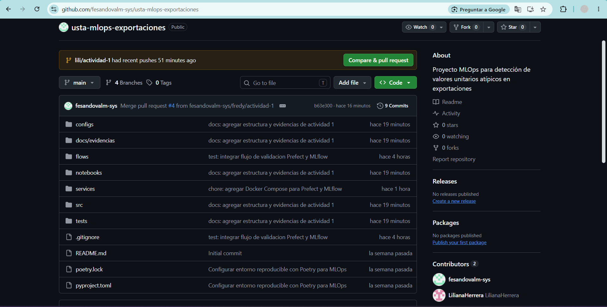
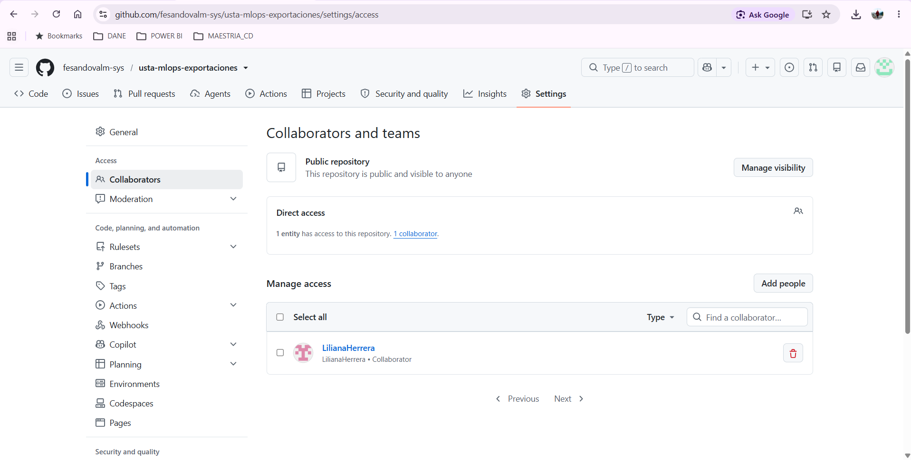
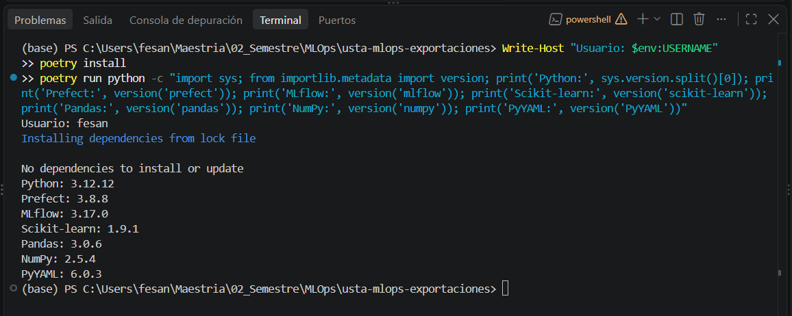
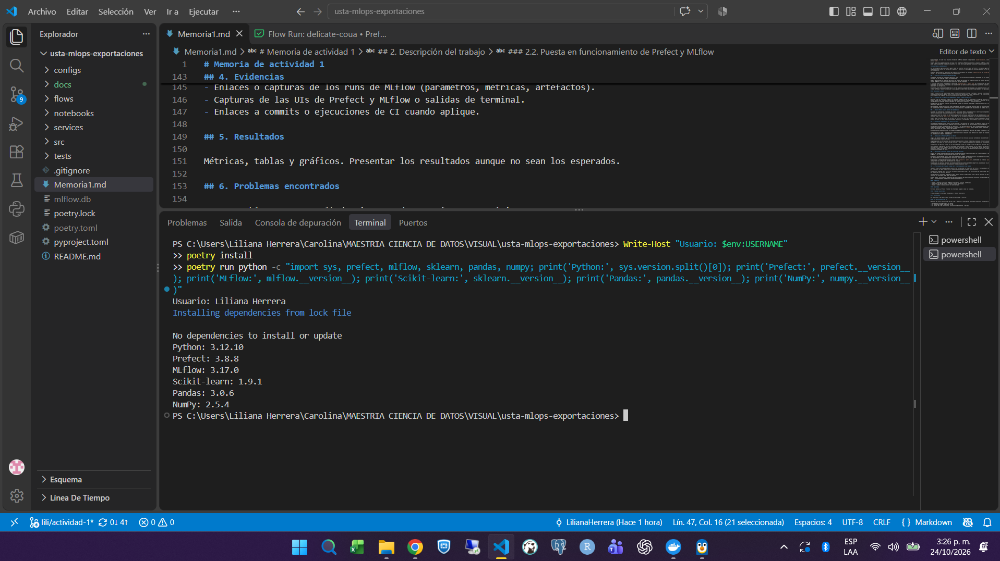
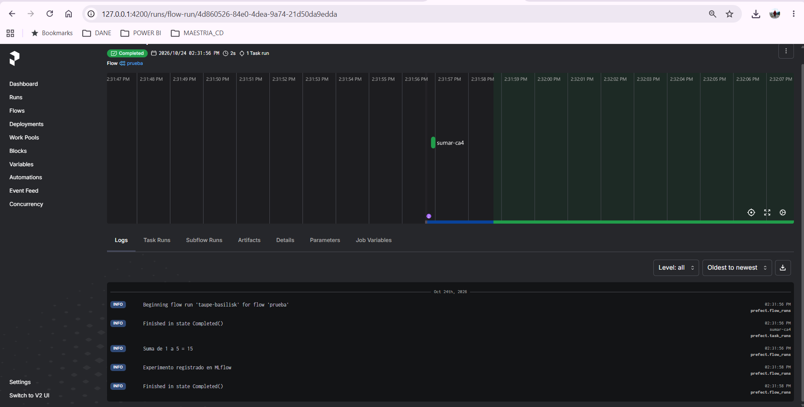
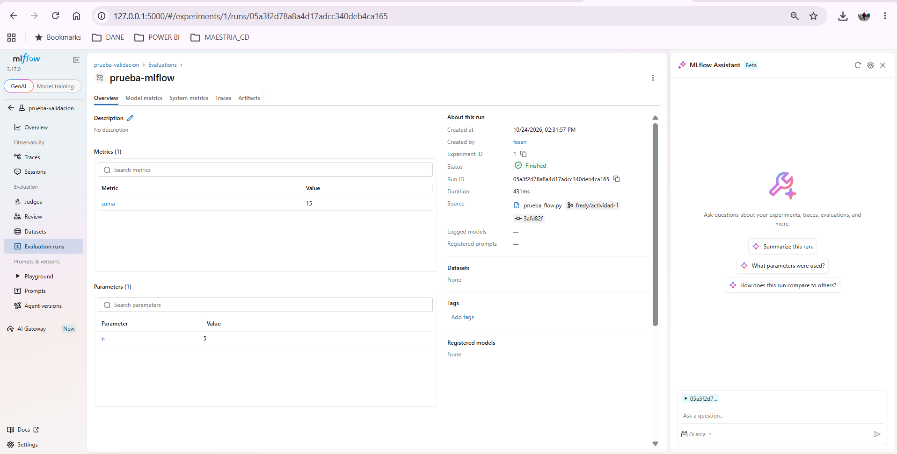
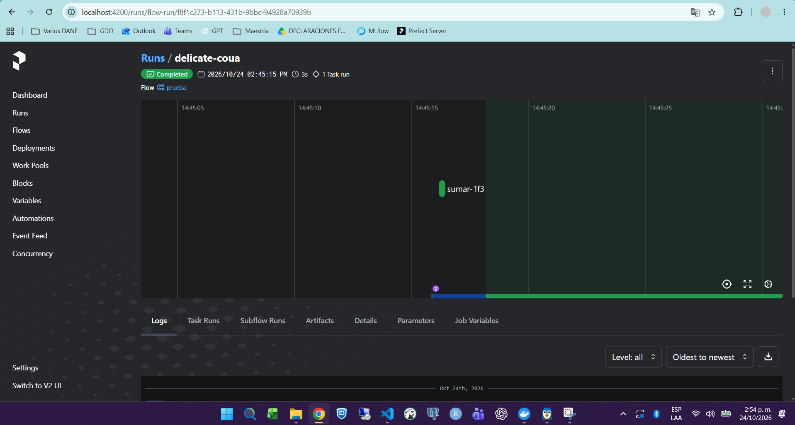
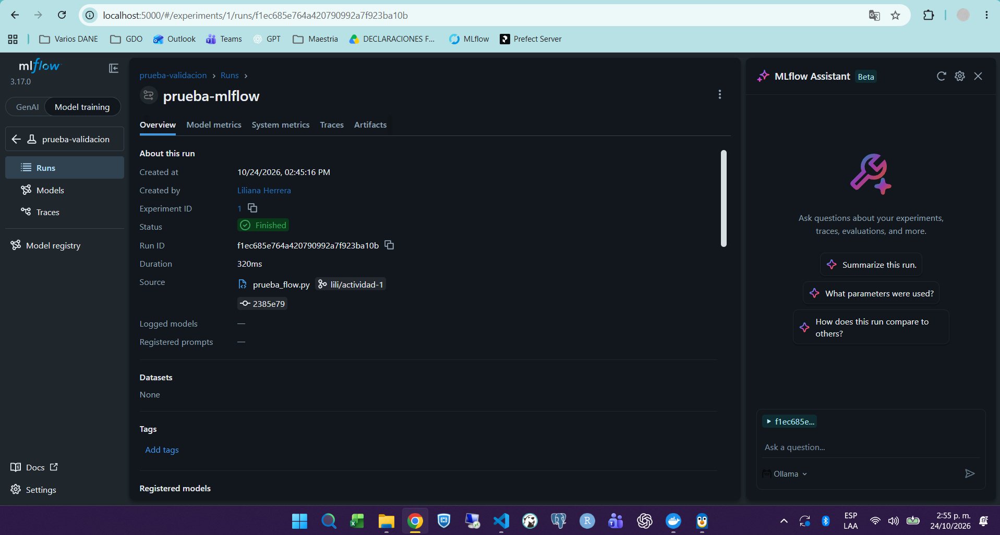
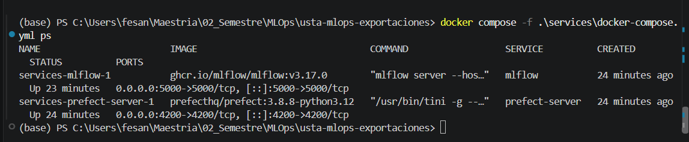

# Memoria de actividad 1
## Fundamentos, versionamiento y tracking

*Universidad:* Universidad Santo Tomás  
*Programa:* Maestría en Ciencia de Datos  
*Asignatura:* MLOps  
*Docente:* Henry Cala  

*Integrantes:*
- Fredy Ernesto Sandoval Méndez
- Liliana Carolina Herrera Prieto

*Repositorio:* https://github.com/fesandovalm-sys/usta-mlops-exportaciones

*Fecha:* 24 de octubre de 2026

## 1. Objetivo

Familiarizarse con los fundamentos y las principales herramientas utilizadas en MLOps, mediante un primer acercamiento práctico al control de versiones con Git y GitHub, la gestión de entornos y dependencias con Poetry, el uso de contenedores con Docker, la orquestación de flujos de trabajo con Prefect y el seguimiento de experimentos con MLflow, con el fin de comprender su funcionamiento e importancia en la organización, reproducibilidad y trazabilidad de proyectos de aprendizaje automático.

## 2. Descripción del trabajo

La actividad permitió conocer cómo se relacionan el control de versiones, la gestión de dependencias, la orquestación de tareas y el seguimiento de experimentos, así como enfrentar algunas dificultades técnicas habituales durante la preparación de un entorno de desarrollo.

### 2.1. Estructura del repositorio y preparación del entorno

Inicialmente, consultamos y clonamos el repositorio del docente, con el propósito de disponer de los materiales de referencia y conocer la organización propuesta para las actividades del curso.

Posteriormente, creamos nuestro propio repositorio en GitHub, denominado **`usta-mlops-exportaciones`**, (https://github.com/fesandovalm-sys/usta-mlops-exportaciones) para desarrollar las actividades de manera colaborativa. Configuramos una rama principal (`main`) y ramas individuales (`lili/actividad-1` y `fredy/actividad-1`), lo que nos permitió comprender cómo trabajar sobre un mismo proyecto conservando el historial y los aportes de cada integrante. Escogimos el nombre de `exportaciones` pensando en realizar, en los casos de uso, una aproximación a nuestro trabajo de tesis sobre observabilidad en el procesamiento de los datos de la operación estadística de exportaciones del DANE, dado que dentro de la misma tendremos pasos de detección de atípicos.

Para preparar el entorno utilizamos Python 3.12, Visual Studio Code y Poetry, incorporando las librerías necesarias para trabajar con Prefect, MLflow y Scikit-learn.

Para organizar el proyecto, adoptamos una estructura de carpetas basada en las orientaciones del docente, con el propósito de separar los componentes del desarrollo y facilitar la incorporación progresiva de nuevas funcionalidades durante el curso.

La estructura del repositorio comprende los siguientes elementos:

- **`configs/`:** destinada a los archivos de configuración del proyecto.
- **`docs/`:** contiene la documentación complementaria y las evidencias de las actividades realizadas.
- **`flows/`:** almacena los flujos de trabajo desarrollados con Prefect, incluido `prueba_flow.py`.
- **`notebooks/`:** destinada al desarrollo de ejercicios de exploración y análisis mediante cuadernos de Jupyter.
- **`services/`:** contiene el archivo `docker-compose.yml`, utilizado para administrar los servicios de Prefect y MLflow mediante Docker.
- **`src/`:** destinada al código fuente de los componentes que se desarrollen durante el proyecto.
- **`tests/`:** reservada para las pruebas del código y la validación de su funcionamiento.
- **`.gitignore`:** establece los archivos y directorios que se excluyen del control de versiones.
- **`README.md`:** contiene la descripción general del repositorio.
- **`pyproject.toml` y `poetry.lock`:** permiten definir y controlar las dependencias necesarias para reproducir el entorno.
- **`Memoria1.md`:** documento que registra el desarrollo, las decisiones técnicas, las evidencias y los resultados de la primera actividad.

Adicionalmente, se generan archivos locales como `mlflow.db` y `poetry.toml`, asociados con el almacenamiento de experimentos y la configuración particular del entorno, respectivamente. Estos archivos se mantienen excluidos del control de versiones.

### 2.2. Puesta en funcionamiento de Prefect y MLflow

Una vez preparado el entorno, iniciamos los servicios de Prefect y MLflow para conocer sus interfaces y comprobar su funcionamiento.

Aunque inicialmente exploramos Docker y las herramientas de administración de contenedores de Visual Studio Code, optamos por ejecutar los servicios directamente mediante Poetry, siguiendo la alternativa sin Docker contemplada en las instrucciones del docente.

Para ello, iniciamos los servidores locales y verificamos el acceso a sus interfaces:

- **Prefect:** `http://127.0.0.1:4200`
- **MLflow:** `http://127.0.0.1:5000`

Este acercamiento nos permitió reconocer las diferencias entre ambas herramientas: Prefect facilita la organización, ejecución y supervisión de flujos de trabajo, mientras que MLflow permite registrar y consultar la información asociada con los experimentos.

### 2.3. Ejecución del flujo de prueba con Prefect y MLflow

Con los servicios en funcionamiento, realizamos las pruebas del archivo **`flows/prueba_flow.py`**, tomando como referencia el código proporcionado por el docente.

El ejercicio consiste en ejecutar un flujo denominado `prueba`, que utiliza una tarea para calcular la suma de los números del 1 al 5. El resultado esperado es 15.

Posteriormente, el mismo flujo registra información en MLflow mediante el experimento `prueba-validacion`, incluyendo el parámetro `n` y la métrica `suma`.

Durante la práctica pudimos observar el flujo en la interfaz de Prefect y consultar su registro en MLflow, comprobando cómo una ejecución puede quedar documentada en ambas herramientas. Así mismo verificamos que eran accesibles en ambos equipos de los integrantes.

### 2.4. Control de versiones y reproducibilidad

Finalmente, revisamos el estado del repositorio local y su sincronización con GitHub, comprobando que los avances realizados estuvieran asociados con las ramas de trabajo correspondientes.

También identificamos la necesidad de excluir del control de versiones los archivos propios del entorno de ejecución, como las bases de datos locales de MLflow y las configuraciones específicas de cada computador.

A través de este proceso comprendimos la función de `pyproject.toml` y `poetry.lock` en la reproducción del entorno, así como la importancia de mantener una estructura organizada y una documentación que permita a otros integrantes ejecutar el proyecto sin tener que reconstruir manualmente su configuración.

En conjunto, esta primera actividad fue más allá de instalar y ejecutar herramientas: nos permitió conocer su relación dentro de un flujo de trabajo de MLOps y resolver situaciones técnicas que difícilmente habríamos identificado mediante una aproximación exclusivamente teórica.

## 3. Decisiones técnicas

Durante el desarrollo de la actividad tomamos diferentes decisiones técnicas orientadas a facilitar el aprendizaje, organizar el trabajo colaborativo y garantizar que el entorno fuera funcional y reproducible. Algunas respondieron a las alternativas propuestas por el docente, mientras que otras surgieron de las dificultades encontradas durante la práctica.

### 3.1. Creación de un repositorio independiente para el trabajo colaborativo

Decidimos crear un repositorio propio en la cuenta de GitHub de uno de los integrantes, en lugar de realizar un *fork* del repositorio del docente. Aunque esta última alternativa habría permitido conservar directamente su estructura y facilitar la incorporación de actualizaciones, consideramos más apropiado mantener separados los materiales de referencia y nuestros desarrollos.

Adicionalmente, optamos por utilizar ramas individuales de trabajo en lugar de realizar todas las modificaciones directamente sobre `main`. Con ello buscamos evitar interferencias entre nuestros avances y comprender cómo se gestionan los cambios en un entorno colaborativo.

### 3.2. Uso de Poetry para la gestión de dependencias

Siguiendo las alternativas presentadas en la guía, utilizamos Poetry para administrar el entorno y gestionar las dependencias del proyecto, en lugar de realizar instalaciones individuales mediante `pip`. Igualmente, en el equipo de uno de los integrantes se realizó la instalación de Python mediante Conda. La principal razón fue conocer una herramienta que permite centralizar la definición de las dependencias en `pyproject.toml` y registrar sus versiones específicas en `poetry.lock`, facilitando que los integrantes trabajemos con configuraciones equivalentes.

### 3.3. Ubicación independiente del entorno virtual

Inicialmente trabajamos con un entorno virtual asociado a la ubicación del proyecto. Sin embargo, durante la instalación encontramos inconvenientes relacionados con la longitud de las rutas de Windows en uno de los equipos de los integrantes. Consideramos trasladar nuevamente todo el repositorio a una ubicación más corta, pero finalmente preferimos conservar nuestra organización de carpetas y configurar Poetry para almacenar el entorno virtual en `C:\venvs` para el equipo de este integrante. Para el otro integrante sí se realizó de acuerdo con la guía, dentro del proyecto. Esta alternativa permitió resolver el problema sin modificar nuevamente la ubicación del código ni afectar su relación con GitHub. La experiencia nos ayudó a comprender que el entorno virtual no necesita estar dentro de la carpeta del proyecto y que es posible administrar sus dependencias de manera independiente.

### 3.4. Modalidades de ejecución de Prefect y MLflow

La guía del docente presenta dos alternativas para iniciar los servicios: utilizar contenedores mediante Docker Compose o ejecutarlos directamente desde un entorno Python. Decidimos utilizar inicialmente la segunda alternativa, para comprender el funcionamiento de Prefect y MLflow.

Posteriormente, repetimos el ejercicio utilizando Docker Desktop y Docker Compose, con el propósito de familiarizarnos con el uso de contenedores y facilitar la puesta en marcha conjunta de Prefect y MLflow, enconstrando los mismos resultados. Esta experiencia también nos permitió explorar una alternativa que favorece la reproducibilidad y simplifica la administración del entorno para las siguientes actividades del curso.

### 3.5. Exclusión de archivos locales del control de versiones

Frente a los archivos asociados con el funcionamiento de las herramientas versiondos en GitHub, optamos por excluir inicialmente los archivos locales que no forman parte del código fuente ni de las dependencias necesarias para reproducir el proyecto. En particular, configuramos exclusiones locales para `mlflow.db`, `poetry.toml`, `mlruns/`, `mlflow_store/` y `.prefect/` manteniendo los archivos `pyproject.toml` y `poetry.lock` como parte de la configuración reproducible del proyecto. Esta decisión nos permitió reconocer la diferencia entre los archivos que deben compartirse para ejecutar un proyecto y aquellos que corresponden exclusivamente al funcionamiento de una instalación local. 

### 3.6. Priorización del flujo de prueba sobre el entrenamiento de un modelo

Para esta primera actividad decidimos concentrarnos en comprender la integración de Prefect y MLflow mediante el flujo de prueba proporcionado por el docente, en lugar de desarrollar inmediatamente una pipeline propia de entrenamiento. Esta decisión responde al interés de comprender a fondo primero cómo se ejecuta y supervisa un flujo, cómo se registran sus parámetros y métricas, y cómo se consultan los resultados desde ambas herramientas.

De esta manera, priorizamos la comprensión del funcionamiento del entorno antes de incorporar la complejidad adicional del procesamiento de datos y el entrenamiento de modelos de aprendizaje automático.

## 4. Evidencias

### 4.1. Configuración del entorno y ejecución

A continuación, se presentan las evidencias del desarrollo de la actividad, que permiten verificar la configuración del entorno, el trabajo colaborativo y la ejecución de los servicios y flujos de prueba con Prefect y MLflow.

| Evidencia | Descripción |
|---|---|
| **01. Repositorio en GitHub**  | Repositorio compartido para el desarrollo de las actividades de MLOps. |
| **02. Colaboradores**  | Evidencia de colaboradores en el repositorio de GitHub. |
| **03. Entorno Poetry - Fredy**  | Verificación del entorno de Python administrado con Poetry en el equipo de Fredy. |
| **04. Entorno Poetry - Liliana**  | Verificación del entorno de Python administrado con Poetry en el equipo de Liliana. |
| **05. Ejecución de Prefect - Fredy**  | Evidencia de la ejecución del flujo de prueba en Prefect desde el entorno de Fredy. |
| **06. Experimento MLflow - Fredy**  | Registro del experimento de prueba en MLflow desde el entorno de Fredy. |
| **07. Ejecución de Prefect - Liliana**  | Ejecución del flujo `prueba`, con estado `Completed`, que confirma el resultado de la operación `Suma de 1 a 5 = 15` desde el entorno de Liliana. |
| **08. Experimento MLflow - Liliana**  | Registro del experimento `prueba-validacion`, con ejecución `prueba-mlflow`, parámetro `n = 5` y métrica `suma = 15` desde el entorno de Liliana. |
| **09. Servicios con Docker Compose**  | Evidencia de la ejecución conjunta de los contenedores de Prefect y MLflow mediante Docker Compose, utilizando los puertos 4200 y 5000, respectivamente. |

### 4.2. Historial de commits y control de versiones

Como evidencia complementaria, se presentan los historiales de commits de las tres ramas del repositorio. Estos registros permiten consultar la evolución del proyecto, identificar los aportes de cada integrante y verificar la trazabilidad de los cambios realizados mediante Git y GitHub.

| Historial de commits | Descripción |
|---|---|
| **Rama principal (`main`)**    [Consultar historial de commits](https://github.com/fesandovalm-sys/usta-mlops-exportaciones/commits/main/) | Contiene los cambios integrados al repositorio principal. |
| **Rama de Fredy (`fredy/actividad-1`)**    [Consultar historial de commits](https://github.com/fesandovalm-sys/usta-mlops-exportaciones/commits/fredy/actividad-1/) | Permite consultar los aportes individuales de Fredy. |
| **Rama de Liliana (`lili/actividad-1`)**    [Consultar historial de commits](https://github.com/fesandovalm-sys/usta-mlops-exportaciones/commits/lili/actividad-1/) | Permite consultar los avances individuales de Liliana. |

## 5. Resultados

Los resultados obtenidos permitieron comprobar el funcionamiento de las herramientas utilizadas durante la actividad y su integración dentro de un entorno inicial de MLOps. A continuación, se presenta un resumen de las principales verificaciones realizadas.

| Componente | Resultado obtenido |
|---|---|
| **Git y GitHub** | Repositorio compartido con tres ramas de trabajo (`main`, `lili/actividad-1` y `fredy/actividad-1`), que permite gestionar los aportes individuales y consolidar los cambios. |
| **Python y Poetry** | Entorno Python 3.12 con dependencias administradas mediante `pyproject.toml` y `poetry.lock`. |
| **Docker Compose** | Ejecución conjunta de los dos servicios: Prefect 3.8.8 y MLflow 3.17.0, mediante los puertos 4200 y 5000, respectivamente. |
| **Prefect** | Ejecución satisfactoria del flujo `prueba`, con estado `Completed`, una tarea ejecutada y resultado de la suma igual a 15. |
| **MLflow** | Experimento `prueba-validacion` registrado correctamente, con estado `Finished`, parámetro `n = 5` y métrica `suma = 15`. |

Los resultados fueron satisfactorios para el alcance de esta primera actividad, dado que permitieron comprobar la ejecución de un flujo sencillo y el registro de sus parámetros y resultados en las herramientas correspondientes.

## 6. Problemas encontrados

Uno de los primeros inconvenientes se presentó durante la instalación de las dependencias. La ubicación inicial del proyecto en uno de los  equipos Windows de nuestros integrantes tenía una ruta extensa y la instalación de Prefect generó errores relacionados con la creación de archivos. En un primer momento trasladamos el repositorio a una ubicación más corta. Finalmente, resolvimos el inconveniente configurando Poetry para almacenar el entorno virtual en una ruta independiente y más corta (`C:\venvs`), sin necesidad de volver a trasladar los archivos del proyecto. Esta experiencia nos permitió comprender mejor la diferencia entre el código del proyecto, su historial de versiones y el entorno donde se ejecutan las dependencias. También evidenció la importancia de verificar el estado de Git antes de realizar cambios en la organización de los archivos.

Así mismo, durante el inicio de Prefect encontramos un error relacionado con el bloqueo de la base de datos SQLite (`database is locked`). Inicialmente parecía que el servicio no había iniciado correctamente; sin embargo, al consultar su interfaz web comprobamos que el servidor estaba respondiendo.

Uno de los aspectos que inicialmente generó dudas fue encontrar las interfaces de Prefect y MLflow sin registros de ejecución. Posteriormente comprendimos que iniciar los servidores no equivale a ejecutar un flujo y que los resultados aparecen una vez se realizan las pruebas correspondientes.

## 7. Conclusiones

El desarrollo de esta primera actividad nos permitió comprender que MLOps involucra un conjunto de prácticas y herramientas orientadas a organizar, automatizar y dar trazabilidad a su ciclo de vida. A través de los ejercicios realizados, logramos relacionar conceptos como el control de versiones, la gestión de dependencias, la orquestación de procesos y el seguimiento de experimentos.

Uno de los aprendizajes más importantes fue reconocer el valor de contar con un entorno reproducible. Las dificultades que encontramos durante la instalación y configuración de las herramientas nos ayudaron a entender que es necesario documentar sus dependencias, controlar las versiones y facilitar que otra persona pueda ejecutarlo bajo condiciones equivalentes. En este sentido, Poetry, Git y GitHub resultaron fundamentales para comprender cómo se organiza y comparte un proyecto de manera colaborativa.

Asimismo, la ejecución del flujo de prueba nos permitió observar cómo Prefect y MLflow se complementan. Mientras Prefect facilita el seguimiento de las tareas y sus estados de ejecución, MLflow conserva los parámetros y resultados de los experimentos. La posterior incorporación de Docker Compose nos permitió conocer una alternativa para administrar ambos servicios de manera conjunta, simplificando su puesta en funcionamiento.

Como oportunidades de mejora, identificamos la necesidad de profundizar en la automatización de pruebas mediante herramientas de integración continua, fortalecer la documentación para facilitar la reproducción del entorno y avanzar progresivamente hacia la construcción de una pipeline propia que incorpore el procesamiento de datos, el entrenamiento y la evaluación de modelos.

En conclusión, esta actividad nos proporcionó una primera experiencia práctica con los fundamentos de MLOps y una base tecnológica sobre la cual podremos desarrollar las siguientes actividades del curso con mayor conocimiento de las herramientas y de su aplicación conjunta.

## 8. Uso de herramientas de IA

Durante el desarrollo de la actividad utilizamos ChatGPT como herramienta de apoyo para el aprendizaje, la resolución de dificultades técnicas y la elaboración de la documentación académica. Su utilización estuvo orientada principalmente a comprender conceptos, interpretar errores y explorar alternativas de solución, manteniendo la ejecución y verificación de los procedimientos bajo nuestra responsabilidad.

### 8.1. Herramientas utilizadas y finalidad

ChatGPT se utilizó como apoyo para interpretar mensajes de error relacionados con Git, Poetry, Prefect, MLflow y Docker; comprender los comandos necesarios para administrar el repositorio y sus ramas; y recibir orientaciones durante la instalación y configuración del entorno.

También se utilizó para revisar y mejorar la redacción de la memoria, organizar las actividades realizadas de acuerdo con las instrucciones del docente y presentar los resultados de manera clara y coherente.

### 8.2. Contribución de los integrantes

Los integrantes participaron en las decisiones técnicas de cómo abordar el ejercicio, la ejecución del ejercicio mismo, cómo resolver las dificultades a partir de las opciones presentadas, la creación y organización del repositorio compartido en GitHub junto con las evidencias solicitadas. El trabajo colaborativo incluyó la revisión de los avances, la sincronización de cambios mediante GitHub y la comprobación práctica del funcionamiento de las herramientas. Las instalaciones, la ejecución de comandos, la administración de los repositorios, la puesta en funcionamiento de los servicios, la ejecución del flujo de prueba y la obtención de evidencias fueron realizadas directamente por los integrantes desde sus respectivos entornos de trabajo, tomando como referencia las instrucciones y el código proporcionados por el docente.

### 8.3. Actividades realizadas directamente y revisión de las recomendaciones de IA

Las respuestas de ChatGPT se utilizaron como orientación y no se asumieron como correctas sin comprobarlas. Durante el proceso revisamos, ajustamos o descartamos algunas recomendaciones, entre ellas:

- **Organización del repositorio:** inicialmente se contempló realizar un *fork* del repositorio del docente, pero preferimos crear uno independiente, conforme a las necesidades del trabajo colaborativo y las instrucciones de la actividad.
- **Configuración del entorno:** ante los problemas relacionados con las rutas de Windows, revisamos distintas alternativas y finalmente optamos por mantener la ubicación del proyecto y configurar una ruta independiente para el entorno virtual de Poetry.
- **Alcance de la actividad:** ajustamos las propuestas iniciales de documentación para concentrarnos en los fundamentos de MLOps y la validación de herramientas, sin presentar el entrenamiento de un modelo propio como una actividad obligatoria.
- **Documentación académica:** revisamos y modificamos los textos propuestos por la IA para que reflejaran las actividades realmente realizadas, las dificultades encontradas y los aprendizajes obtenidos.

Finalmente, los resultados presentados en la memoria corresponden a ejecuciones reales verificadas en las interfaces de Prefect y MLflow. La IA no sustituyó estas pruebas ni generó los resultados experimentales, sino que sirvió como herramienta de consulta y acompañamiento durante el proceso de aprendizaje.
