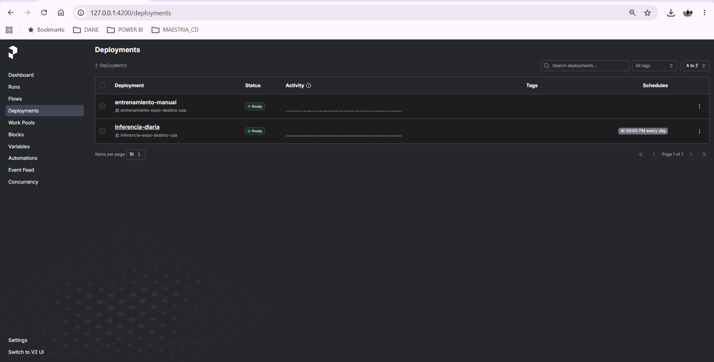
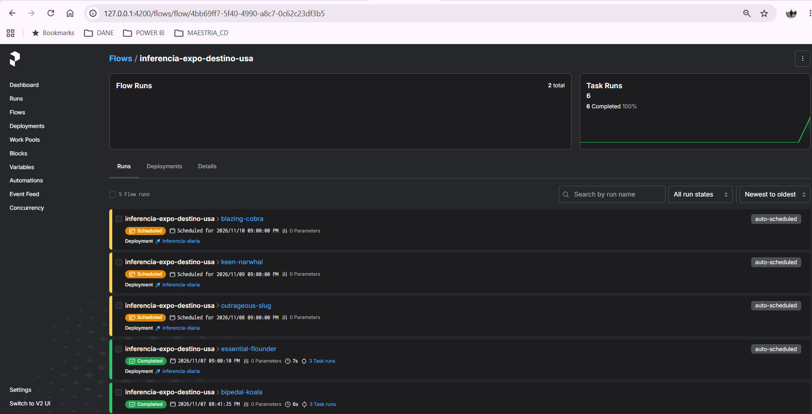
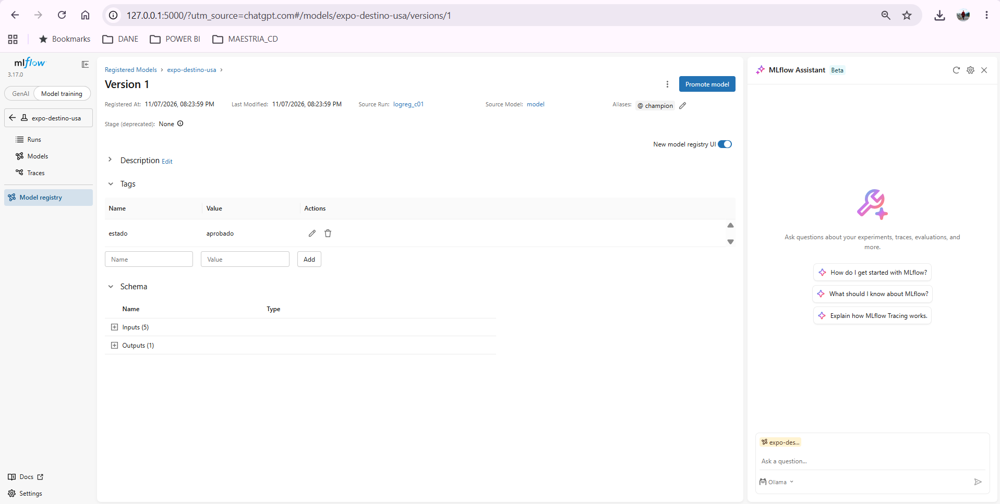
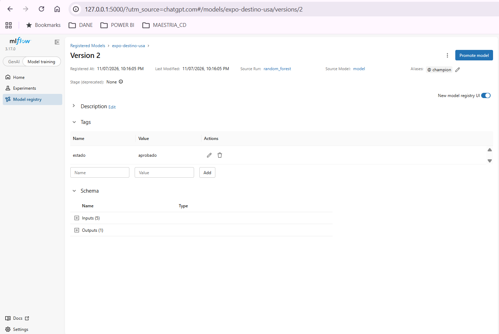
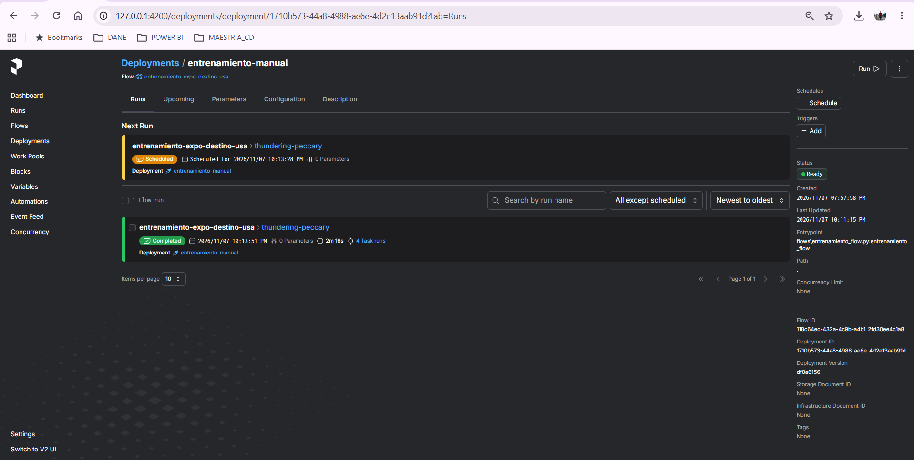
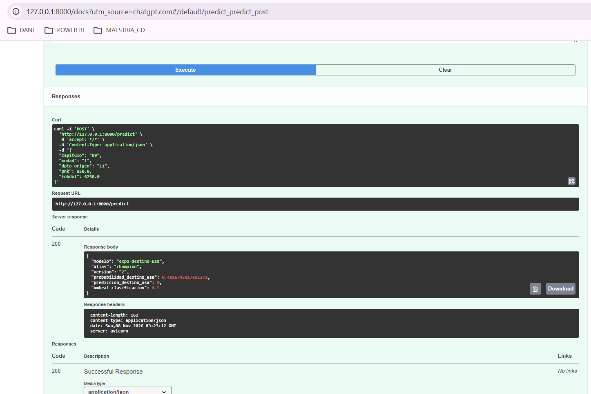
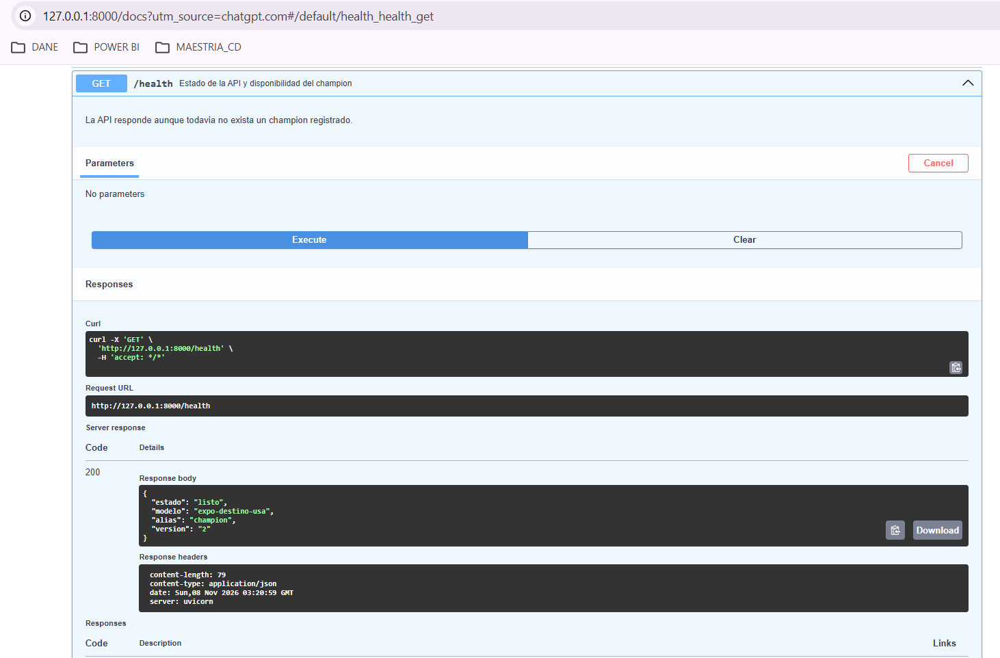
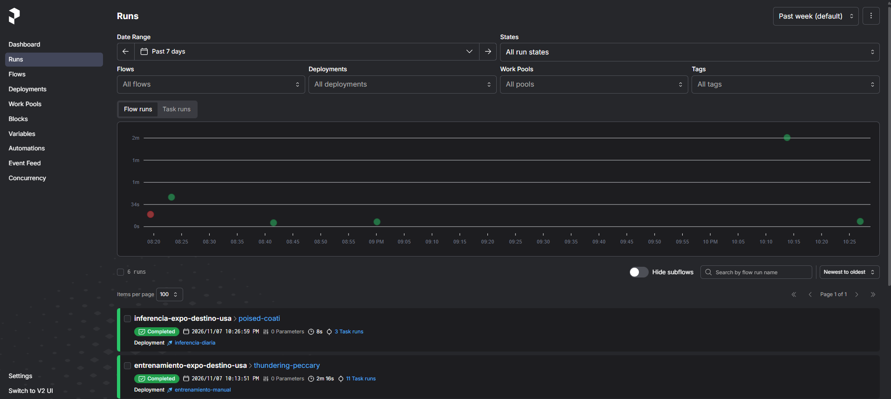
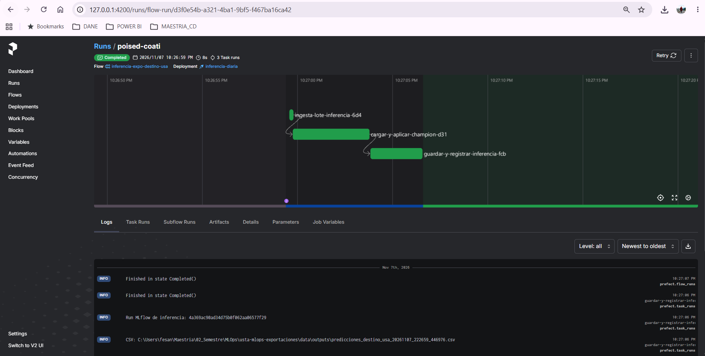
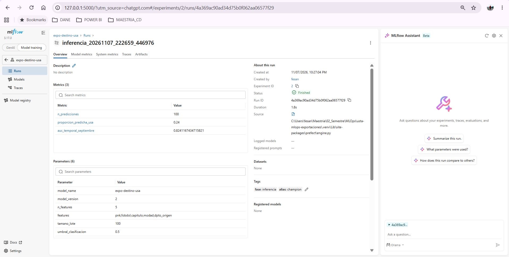

# Memoria de actividad 2
## Pipeline y empaquetado

**Universidad:** Universidad Santo Tomás  
**Programa:** Maestría en Ciencia de Datos  
**Asignatura:** MLOps  
**Docente:** Henry Cala  
**Integrantes:** Fredy Ernesto Sandoval Méndez y Liliana Carolina Herrera Prieto  
**Repositorio:** https://github.com/fesandovalm-sys/usta-mlops-exportaciones

## 1. Objetivo

Implementar y comprobar un ciclo MLOps para estimar la probabilidad de que una exportación colombiana tenga como destino Estados Unidos, integrando preparación de datos, entrenamiento, evaluación, registro de versiones, inferencia por lotes y una API. Se amplió la infraestructura de la Actividad 1 mediante Prefect, MLflow, configuración YAML y FastAPI.

## 2. Descripción del trabajo

**Preparación de datos.** Se utilizaron microdatos públicos de exportaciones del DANE, disponibles en el Archivo Nacional de Datos (ANDA), correspondientes al periodo comprendido entre agosto de 2025 y septiembre de 2026. Para su procesamiento, se desarrolló el módulo `src/ingesta_anda.py`, que permite leer los archivos CSV contenidos en estructuras ZIP anidadas, mediante una estrategia de lectura por bloques que optimiza el uso de memoria y facilita el tratamiento de grandes volúmenes de información. El procedimiento incluyó la normalización de formatos numéricos y categóricos, la validación de campos obligatorios y la aplicación de controles de calidad para identificar y excluir registros inconsistentes. A partir de las variables `PAIS` y `COD_PAI4`, se construyó la variable objetivo binaria `destino_usa`, que identifica las operaciones dirigidas a Estados Unidos. Finalmente, se generaron tres conjuntos de datos comprimidos, destinados al entrenamiento, la validación temporal y la inferencia del modelo. La consistencia de las transformaciones y las reglas de procesamiento se verificó mediante **21 pruebas automatizadas**, ejecutadas satisfactoriamente.

**Entrenamiento y registro de modelos.** Se desarrolló el módulo `src/modelo.py`, que integra las etapas de preprocesamiento de datos y construcción de clasificadores supervisados mediante Scikit-learn, garantizando la aplicación consistente de las transformaciones durante el entrenamiento y la inferencia. Por su parte, `flows/entrenamiento_flow.py` implementa una pipeline orquestada con Prefect, que automatiza la carga y validación de datos, el entrenamiento de los modelos, la evaluación de su desempeño y el registro de los experimentos en MLflow. Cada ejecución permite almacenar los parámetros de configuración, incluida la selección de variables (`features`) y su cantidad (`n_features`), junto con las métricas de evaluación y la etiqueta `fase=entrenamiento`, facilitando la trazabilidad y comparación de resultados. La configuración de hiperparámetros, los criterios de selección y las condiciones para promover un modelo al alias `champion` se administran mediante `configs/config.yaml` y `configs/features.yaml`, manteniendo separada la configuración de la lógica del programa. Inicialmente se evaluaron dos modelos de regresión logística con diferentes niveles de regularización y, posteriormente, se incorporó Random Forest como alternativa para capturar relaciones no lineales entre las variables predictoras. Esta segunda evaluación permitió comparar los tres candidatos bajo las mismas condiciones de validación y seleccionar el modelo con mejor desempeño según el AUC-ROC.

**Inferencia y servicio del modelo.** Se implementó el módulo `flows/inferencia_flow.py` para automatizar la generación de predicciones a partir del modelo vigente, recuperado directamente desde MLflow mediante el alias `models:/expo-destino-usa@champion`. El flujo selecciona un lote configurable de 100 registros correspondientes a septiembre de 2026, aplica el modelo para estimar las probabilidades de destino a Estados Unidos y genera un archivo CSV identificado con la fecha y hora de ejecución. Adicionalmente, cada proceso de inferencia queda registrado en MLflow con la etiqueta `fase=inferencia`, lo que permite mantener la trazabilidad de las predicciones y de la versión utilizada.

La orquestación se configuró mediante `flows/desplegar.py`, que publica dos despliegues independientes en Prefect: `entrenamiento-manual`, ejecutado bajo demanda, e `inferencia-diaria`, programado mediante la expresión cron `0 21 * * *` para ejecutarse diariamente a las 21:00, hora de Bogotá (`America/Bogota`). El funcionamiento de esta programación se comprobó el 7 de noviembre de 2026, cuando la ejecución automática se inició a las 21:00:10 y finalizó satisfactoriamente con estado `Completed`.

Finalmente, se desarrolló una API con FastAPI en `api/main.py`, que expone los endpoints `GET /health`, para consultar la disponibilidad y versión del modelo, y `POST /predict`, para obtener predicciones a partir de los atributos de una operación de exportación. La API recupera el modelo mediante el alias `champion`, sin depender de una versión fija. Este mecanismo permitió comprobar que, después de promover Random Forest como nuevo `champion` v2 y reiniciar el servicio, la API comenzó a utilizar automáticamente la versión actualizada, sin necesidad de modificar su código. También se verificó que la pipeline de inferencia utilizara la versión 2 para generar un nuevo lote de 100 predicciones.

## 3. Decisiones técnicas

**Problema y selección de variables.** Se optó por abordar un problema de clasificación binaria supervisada, utilizando una variable objetivo observable y verificable, en lugar de desarrollar un modelo para detectar valores FOB atípicos, alternativa considerada inicialmente, pero que requería establecer criterios adicionales para identificar y etiquetar las anomalías. Esta decisión permitió definir un problema de predicción claramente delimitado y evaluar la capacidad discriminatoria de los modelos mediante la métrica AUC-ROC. Se seleccionaron cinco variables predictoras relacionadas con las características de las operaciones de exportación: `capitulo`, correspondiente al capítulo arancelario del producto; `modad`, que identifica la modalidad de exportación; `dpto_origen`, asociado al departamento de origen; `pnk`, que representa el peso neto en kilogramos; y `fobdol`, correspondiente al valor FOB en dólares. Las variables `PAIS` y `COD_PAI4` se utilizaron exclusivamente para construir y validar la etiqueta `destino_usa`, pero se excluyeron del conjunto de predictores para evitar una fuga directa de información (*data leakage*). Por su parte, `periodo` se reservó para establecer la partición cronológica de los datos, mientras que `destino_usa` se definió como la variable objetivo del modelo.

**Ingeniería de variables y preprocesamiento.** Se aplicaron técnicas de ingeniería de características para transformar las variables originales en entradas adecuadas para los algoritmos de clasificación. A partir de los dos primeros dígitos de `POSAR`, se construyó la variable `capitulo`, que permite representar la clasificación arancelaria de los productos a un nivel más agregado. Asimismo, se normalizaron los formatos numéricos y se conservaron los códigos categóricos como texto para preservar los ceros iniciales y evitar interpretaciones numéricas incorrectas. El preprocesamiento se incorporó en un pipeline de Scikit-learn, mediante imputación por mediana para las variables numéricas y por moda para las categóricas, estandarización con `StandardScaler` y codificación *One-Hot* para representar las categorías sin introducir relaciones ordinales artificiales. Esta integración garantiza que las mismas transformaciones se apliquen de manera consistente durante el entrenamiento y la inferencia, reduciendo el riesgo de inconsistencias entre ambas etapas. Aunque se implementaron las opciones de selección de variables `ALL`, `NUMERIC` y `CUSTOM`, los experimentos reportados se realizaron con `ALL`, utilizando las cinco variables predictoras definidas. Se decidió no incorporar características derivadas adicionales, como el valor FOB por kilogramo o interacciones entre variables, para mantener una línea base de modelado controlada y reproducible, priorizando la implementación y validación del ciclo de vida del modelo dentro de la arquitectura MLOps.

**Validación temporal.** Se adoptó una estrategia de partición cronológica de los datos, con el propósito de evaluar la capacidad de generalización de los modelos frente a observaciones posteriores a las utilizadas durante el entrenamiento. Para ello, se definió un conjunto de entrenamiento correspondiente al periodo de agosto de 2025 a mayo de 2026, un conjunto de validación comprendido entre junio y agosto de 2026 y un conjunto independiente de septiembre de 2026, destinado a las pruebas de inferencia y evaluación retrospectiva. Esta decisión se consideró más apropiada que una división aleatoria, dado que permite respetar la secuencia temporal de las operaciones de exportación y aproximarse a un escenario en el que el modelo realiza predicciones sobre información posterior a su entrenamiento. Adicionalmente, septiembre se mantuvo excluido del proceso de selección y promoción del modelo `champion`, evitando utilizar los resultados de ese periodo para favorecer artificialmente el desempeño de los candidatos. De esta manera, se estableció una separación entre las etapas de entrenamiento, selección del modelo y comprobación posterior de su funcionamiento.

**Reproducibilidad y trazabilidad.** Se adoptó una arquitectura modular que separa los datos, el código fuente y los archivos de configuración, con el propósito de facilitar el mantenimiento, la repetición de experimentos y el seguimiento de los resultados obtenidos. Los hiperparámetros de los modelos, los umbrales de evaluación y promoción, y las características seleccionadas se administran mediante archivos YAML, lo que permite realizar ajustes sin modificar directamente la lógica de los programas. Asimismo, el preprocesamiento y el estimador se integraron en una misma pipeline de Scikit-learn, garantizando la aplicación consistente de las transformaciones durante el entrenamiento y la inferencia. Para la trazabilidad de las ejecuciones, se utilizó Prefect como herramienta de orquestación y seguimiento de los flujos, mientras que MLflow permitió registrar los experimentos, sus parámetros, métricas, artefactos y versiones de los modelos, incluyendo la gestión del alias `champion`. Por su parte, GitHub se utilizó para el control de versiones del código, las pruebas automatizadas, la documentación y las evidencias de ejecución, conservando el historial de contribuciones de ambos integrantes. Los microdatos originales, los conjuntos procesados y los artefactos locales se excluyeron del repositorio. De esta manera, se establecieron las condiciones para reconstruir y verificar el procedimiento, reconociendo que la reproducción de los resultados requiere disponer de los mismos insumos, dependencias y configuraciones del entorno de ejecución.

**Modelo y política de promoción.** Se seleccionó inicialmente la regresión logística como modelo de referencia (*baseline*), debido a su aplicabilidad en problemas de clasificación binaria, su interpretabilidad y su capacidad para proporcionar probabilidades estimadas. Se evaluaron dos configuraciones con parámetros de regularización `C=1,0` y `C=0,1`, con el propósito de analizar su comportamiento bajo distintos niveles de penalización. Posteriormente, se incorporó Random Forest como algoritmo alternativo, considerando su capacidad para representar relaciones no lineales e interacciones entre las variables predictoras sin necesidad de especificarlas explícitamente. Los tres candidatos se evaluaron utilizando el mismo conjunto de validación temporal y la métrica AUC-ROC como criterio principal de comparación. Se estableció un umbral mínimo configurable de **0,70**, definido como una condición académica de aceptación y no como garantía de calidad predictiva. La política de promoción implementada en MLflow establece que únicamente se registra una nueva versión del modelo y se actualiza el alias `champion` cuando el candidato supera estrictamente tanto el AUC mínimo configurado como el desempeño del modelo vigente. Los experimentos que no cumplen estas condiciones conservan sus registros, parámetros y métricas, permitiendo documentar los resultados y mantener la trazabilidad de las decisiones. Esta política se comprobó mediante una segunda ejecución del entrenamiento, en la que Random Forest superó el AUC del modelo inicial y fue promovido automáticamente de la versión 1 a la versión 2, sin modificar las reglas de selección.

Las evidencias de ejecución y validación del sistema se encuentran organizadas en el directorio [`docs/actividad-2/evidencias/`](evidencias/). Estas capturas documentan las diferentes etapas de implementación y permiten verificar el funcionamiento de los componentes desarrollados, desde la orquestación de los flujos hasta la actualización del modelo y su utilización en los servicios de inferencia.

### Despliegues de Prefect e inferencia automática

[Despliegues de Prefect](evidencias/02_despliegues_prefect.png) y [ejecución automática](evidencias/11_prefect_inferencia_programada.png).

**Descripción y comprobación.** Se verifica la configuración de dos despliegues independientes para entrenamiento e inferencia, así como la ejecución automática del flujo diario mediante la programación establecida. La ejecución programada finalizó satisfactoriamente con estado `Completed`.

---

### Registro y promoción del modelo champion

[Champion v1](evidencias/06_mlflow_champion_v1.png) y [champion v2](evidencias/15_mlflow_champion_v2.png).

**Descripción y comprobación.** Se evidencia el registro y versionamiento de los modelos en MLflow, junto con la actualización del alias `champion` desde la regresión logística inicial hacia Random Forest, después de superar el AUC del modelo vigente.

---

### Entrenamiento actualizado con Random Forest

[Entrenamiento actualizado](evidencias/14_prefect_entrenamiento_random_forest.png).

**Descripción y comprobación.** Se documenta la ejecución satisfactoria de la pipeline de entrenamiento desde Prefect, incorporando el nuevo candidato Random Forest y conservando las etapas de carga, entrenamiento, evaluación y registro de resultados.

---

### Validación de FastAPI con champion v2

[FastAPI: predicción v2](evidencias/17_fastapi_predict_champion_v2.png) y [verificación del servicio](evidencias/16_fastapi_health_champion_v2.png).

**Descripción y comprobación.** Se comprueba que la API responde correctamente a las solicitudes de consulta y predicción utilizando el modelo `champion` versión 2. La actualización se consiguió mediante el reinicio del servicio, sin modificar el código de la API.

---

### Inferencia con champion v2 y seguimiento en MLflow

[Inferencia con champion v2](evidencias/18_prefect_inferencia_champion_v2.png), [registros de ejecución](evidencias/19_prefect_logs_inferencia_v2.png) y [seguimiento en MLflow](evidencias/20_mlflow_inferencia_champion_v2.png).

**Descripción y comprobación.** Se verifica que la pipeline de inferencia recupera el modelo mediante su alias, utiliza la versión vigente y genera un nuevo lote de 100 predicciones. La ejecución queda registrada tanto en Prefect como en MLflow, permitiendo identificar la versión aplicada y los resultados generados.

---

### Fuentes y preparación de datos

[Consultar fuentes y preparación de datos](fuentes_y_datos.md).

**Descripción y comprobación.** Se documentan la procedencia de los microdatos, las variables seleccionadas, las reglas de transformación y validación, la conformación de los conjuntos temporales y los resultados de los controles de calidad aplicados durante la ingesta.

---

### Trazabilidad del desarrollo colaborativo

[PR #10](https://github.com/fesandovalm-sys/usta-mlops-exportaciones/pull/10), [PR #11](https://github.com/fesandovalm-sys/usta-mlops-exportaciones/pull/11) y [PR #12](https://github.com/fesandovalm-sys/usta-mlops-exportaciones/pull/12).

**Descripción y comprobación.** Se presenta la trazabilidad del desarrollo colaborativo mediante GitHub, incluyendo la implementación de las pipelines y la API, la incorporación de Random Forest y la integración de las evidencias finales. Los Pull Requests permiten identificar los cambios realizados y su incorporación a la rama principal del repositorio.

En conjunto, estas evidencias permiten comprobar el cumplimiento de los requisitos funcionales de la Actividad 2 y, particularmente, la aplicación efectiva de la política de promoción de modelos. La transición del alias `champion` de la versión 1 a la versión 2, seguida de su utilización por FastAPI y por la pipeline de inferencia, demuestra la integración entre Prefect, MLflow y los componentes de servicio desarrollados.

## 5. Resultados

El proceso de ingesta y preparación de datos permitió analizar **559.450 registros originales** de exportaciones, de los cuales **559.397 cumplieron los criterios de calidad establecidos** y 53 fueron excluidos por presentar inconsistencias en las variables requeridas. Los registros válidos se distribuyeron en tres conjuntos de acuerdo con la partición temporal definida para el ejercicio. La proporción de operaciones con destino a Estados Unidos fue del **12,63 %**, lo que evidencia un desbalance entre las clases de la variable objetivo.

| Conjunto | Registros válidos | Destino USA | Porcentaje USA |
|---|---:|---:|---:|
| Entrenamiento | 404.214 | 51.751 | 12,80 % |
| Validación | 114.830 | 14.333 | 12,48 % |
| Septiembre | 40.353 | 4.558 | 11,30 % |
| **Total** | **559.397** | **70.642** | **12,63 %** |

Durante la fase de entrenamiento se evaluaron inicialmente dos configuraciones de regresión logística, diferenciadas por su parámetro de regularización. Posteriormente, se incorporó Random Forest como tercer candidato, manteniendo las mismas variables predictoras y el conjunto de validación temporal para garantizar la comparabilidad de los resultados. La evaluación se realizó mediante AUC-ROC, utilizado como criterio principal para seleccionar y promover el modelo de mejor desempeño.

| Candidato | AUC-ROC de validación | Resultado |
|---|---:|---|
| Regresión logística, `C=1,0` | 0,715765 | Run registrado; no promovido. |
| Regresión logística, `C=0,1` | 0,716009 | Promovido inicialmente como `champion` **v1**. |
| Random Forest | **0,729074** | Promovido posteriormente como `champion` **v2**. |

La nueva ejecución del entrenamiento desde el despliegue manual de Prefect finalizó satisfactoriamente con estado `Completed`. El registro de MLflow confirmó que Random Forest alcanzó un AUC de **0,7290741235**, superando el desempeño de la versión anterior en aproximadamente **0,0131 puntos de AUC**. En consecuencia, el sistema registró una nueva versión del modelo y actualizó automáticamente el alias `champion` de v1 a v2, cumpliendo las condiciones de promoción establecidas en la configuración.

En cuanto a la inferencia, se verificó inicialmente la ejecución automática programada en Prefect, que generó un lote de 100 predicciones. Posteriormente, después de la promoción del nuevo modelo, se ejecutó nuevamente la pipeline de inferencia y se comprobó que las **100 predicciones generadas correspondían a la versión 2**, recuperada mediante el alias `champion`. Esta validación permitió confirmar que el flujo utiliza el modelo vigente sin necesidad de modificar su código ni establecer manualmente el número de versión.

También se comprobó el funcionamiento de FastAPI después de reiniciar el servicio. El endpoint `POST /predict` respondió correctamente con código HTTP 200 y la versión `2` del modelo. Para el registro ilustrativo utilizado en las pruebas (`capitulo=09`, `modad=1`, `dpto_origen=11`, `pnk=850` y `fobdol=6250`), la probabilidad estimada de destino a Estados Unidos pasó de **0,20944 con la versión 1** a **0,48168 con la versión 2**. En ambos casos, la clasificación resultante fue 0 (otro destino), dado que las probabilidades se mantuvieron por debajo del umbral de decisión de 0,50. Esta diferencia refleja el comportamiento de los dos algoritmos frente a una misma entrada, sin que deba interpretarse por sí sola como una mejora en la precisión de esa predicción.

Finalmente, los resultados deben interpretarse considerando el desbalance de clases observado. En la validación inicial, la regresión logística promovida como v1 presentó un recall aproximado del **1,33 %** y un F1 de **0,0258** para la clase USA, lo que indica una capacidad limitada para identificar correctamente los registros de esta categoría bajo el umbral de clasificación utilizado. Aunque Random Forest mejoró el AUC-ROC, esta métrica no permite concluir, por sí sola, que también haya mejorado el recall o el F1. Por otra parte, el AUC retrospectivo de **0,8833**, obtenido con el modelo inicial sobre una muestra de 100 registros de septiembre, constituye una evaluación exploratoria y no es directamente comparable con el AUC de validación calculado sobre 114.830 observaciones. Estos resultados muestran que se cumplió el objetivo funcional de la arquitectura MLOps, aunque persisten oportunidades de mejora en el desempeño predictivo del modelo.

## 6. Problemas encontrados

Durante el desarrollo se presentaron dificultades relacionadas con la preparación de los datos, la compatibilidad de las herramientas y la gestión del estado de los modelos entre diferentes entornos de ejecución. Estos inconvenientes permitieron identificar aspectos importantes para garantizar la estabilidad, reproducibilidad y trazabilidad de la solución implementada.

**Reformulación del problema de modelado.** Durante la definición del caso de uso, se planteó inicialmente desarrollar un modelo para detectar valores atípicos en las exportaciones, particularmente en la variable de valor FOB. Sin embargo, al revisar los requisitos de evaluación de la actividad, se identificó una limitación metodológica: los microdatos disponibles no contaban con etiquetas verificadas que permitieran distinguir entre registros normales y anomalías reales. Aunque era posible aplicar técnicas de detección no supervisada, estas no permitían calcular de manera válida el AUC-ROC sin disponer de una variable de referencia que identificara los casos positivos y negativos. Ante esta dificultad, se decidió reformular el problema como una clasificación binaria supervisada para predecir si una operación de exportación tiene como destino Estados Unidos. Esta alternativa permitió construir una variable objetivo observable (`destino_usa`) a partir de los códigos de país de destino, establecer conjuntos de entrenamiento y validación temporal y evaluar los modelos mediante AUC-ROC. El cambio de enfoque respondió a la necesidad de garantizar una evaluación cuantitativa verificable y cumplir los objetivos académicos de la actividad, sin depender de etiquetas de anomalías construidas mediante supuestos no validados.

**Procesamiento y calidad de los datos.** La ingesta de los microdatos públicos del DANE presentó desafíos debido a la estructura de archivos ZIP anidados, los formatos numéricos utilizados en Colombia y la necesidad de conservar los ceros iniciales de las variables categóricas. Para resolverlos, se implementó una estrategia de lectura por bloques, acompañada de transformaciones explícitas para normalizar los valores y validar la estructura de los registros. Adicionalmente, se desarrollaron pruebas automatizadas para comprobar el comportamiento de las reglas de procesamiento y detectar posibles inconsistencias antes de generar los conjuntos de entrenamiento, validación e inferencia.

**Compatibilidad y serialización de modelos.** Durante las primeras ejecuciones de entrenamiento se presentó un error de compatibilidad entre MLflow y `skops`, debido a que el proceso de carga del modelo identificó el tipo `numpy.dtype` como no confiable. Para solucionar este inconveniente, se configuró una lista explícita de tipos permitidos, manteniendo el mecanismo de validación requerido para recuperar los modelos serializados. Posteriormente, con la incorporación de Random Forest, fue necesario ampliar esta configuración para admitir los tipos asociados con la estructura interna de los árboles de decisión. Estos ajustes permitieron completar el registro y la recuperación de los modelos desde MLflow.

**Persistencia y gestión del modelo entre entornos.** Durante la integración del trabajo colaborativo se identificó que el código y los archivos de configuración almacenados en GitHub no incluían automáticamente el estado de los servicios locales, particularmente los experimentos, las versiones registradas y los alias administrados por MLflow. Por esta razón, el modelo `champion` v1, disponible en el entorno donde se realizó el entrenamiento inicial, no aparecía automáticamente al ejecutar el proyecto en otro computador. Se diferenciaron entonces los componentes versionados mediante Git de los artefactos y metadatos conservados por los servicios de ejecución. Finalmente, la promoción de Random Forest a `champion` v2 se comprobó en el servidor de MLflow que mantenía el registro del modelo original, lo que permitió verificar correctamente la comparación de desempeño y la actualización del alias.

En conjunto, estas situaciones evidenciaron que la reproducibilidad de una solución MLOps no depende únicamente del control de versiones del código, sino también de la consistencia de los datos, la compatibilidad de las dependencias y la persistencia de los registros y artefactos utilizados durante el ciclo de vida del modelo.

## 7. Conclusiones

El desarrollo de la Actividad 2 permitió cumplir los objetivos funcionales propuestos mediante la implementación de una arquitectura MLOps que integra las etapas de preparación de datos, entrenamiento, evaluación, registro, versionamiento e inferencia de modelos de aprendizaje supervisado. La utilización de Prefect facilitó la orquestación de los procesos de entrenamiento y la programación de inferencias diarias, mientras que MLflow permitió mantener la trazabilidad de los experimentos, comparar sus resultados y administrar las versiones de los modelos. Por su parte, FastAPI proporcionó una interfaz para consultar el estado del servicio y generar predicciones a partir del modelo vigente.

Uno de los resultados más relevantes fue la comprobación del mecanismo de promoción automática del modelo `champion`. Inicialmente, una regresión logística fue registrada como versión 1 y, posteriormente, Random Forest obtuvo un mejor AUC-ROC de validación, lo que permitió su promoción a la versión 2 conforme a las reglas establecidas. Se verificó que tanto el flujo de inferencia como la API podían recuperar el modelo actualizado mediante su alias, sin necesidad de modificar el código fuente. Esta funcionalidad demuestra la utilidad de desacoplar los componentes de entrenamiento y consumo del modelo, facilitando su actualización y mantenimiento.

Desde el punto de vista del desarrollo colaborativo, la separación de responsabilidades, la organización modular del repositorio y la utilización de archivos de configuración externos facilitaron la integración de los aportes individuales. Asimismo, el control de versiones mediante GitHub, las pruebas automatizadas y el registro de ejecuciones contribuyeron a fortalecer la reproducibilidad y trazabilidad del trabajo. Las dificultades relacionadas con la ingesta, la serialización y la persistencia local de MLflow permitieron comprender la importancia de considerar tanto el código como los datos, las dependencias y los artefactos del modelo dentro de una solución MLOps.

En cuanto al desempeño predictivo, aunque Random Forest presentó una mejora en el AUC-ROC respecto a las regresiones logísticas evaluadas, los resultados evidenciaron limitaciones asociadas al desbalance de clases y a la baja capacidad de identificación de operaciones con destino a Estados Unidos observada en el modelo inicial. Por esta razón, el incremento del AUC no debe interpretarse como una mejora general de todas las métricas de clasificación. Como trabajo futuro, se podría ampliar la evaluación del recall, la precisión y el F1 por clase, revisar la calibración de probabilidades y los umbrales de decisión, incorporar nuevas características predictoras y realizar validaciones temporales sobre periodos adicionales.

En conclusión, el principal resultado del ejercicio fue la construcción y validación de un flujo de trabajo MLOps funcional, reproducible bajo las condiciones documentadas y capaz de gestionar la actualización de modelos mediante criterios de evaluación previamente definidos. El prototipo constituye una aplicación académica sobre microdatos públicos de exportaciones y no corresponde a un sistema oficial de producción, validación o generación de estadísticas del DANE.

## 8. Declaración de uso de inteligencia artificial

Para el desarrollo de la presente actividad se emplearon herramientas de inteligencia artificial como apoyo técnico y académico en la estructuración y revisión de código, la formulación de pruebas automatizadas, la elaboración de comandos de ejecución, el diagnóstico de errores y la organización de la documentación. Estas herramientas facilitaron la exploración de alternativas de implementación y la identificación de posibles soluciones a problemas técnicos, sin sustituir el análisis, la validación ni la toma de decisiones de los autores.

**Liliana Carolina Herrera Prieto** participó en el desarrollo y verificación del proceso de ingesta de microdatos, la implementación de pruebas automatizadas y la incorporación y evaluación del algoritmo Random Forest. Por su parte, **Fredy Ernesto Sandoval Méndez** desarrolló e integró los flujos de entrenamiento e inferencia, la configuración de despliegues en Prefect, el seguimiento y versionamiento de modelos mediante MLflow y el servicio de predicción implementado con FastAPI. Asimismo, realizó las verificaciones funcionales relacionadas con la promoción de modelos, la ejecución programada de inferencias y las respuestas del servicio.

Ambos autores participaron en la revisión de los resultados, la interpretación de las métricas y la verificación de las evidencias obtenidas. Las propuestas generadas mediante inteligencia artificial fueron contrastadas con el código implementado, la documentación técnica y las características de los datos utilizados. Aquellas que no correspondían con el funcionamiento real del sistema, las restricciones metodológicas o las reglas de promoción definidas fueron ajustadas o descartadas.

En consecuencia, las herramientas de inteligencia artificial se utilizaron exclusivamente como recursos de asistencia técnica y académica. La formulación del problema, las decisiones metodológicas, la implementación y validación de la solución, el análisis crítico de los resultados y las conclusiones corresponden a **Liliana Carolina Herrera Prieto y Fredy Ernesto Sandoval Méndez**, quienes asumen la responsabilidad académica por la originalidad, el contenido y los resultados de esta entrega.
